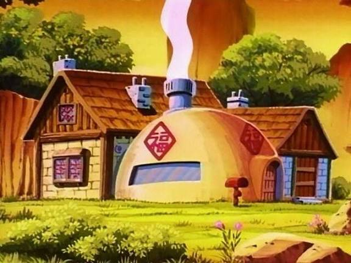
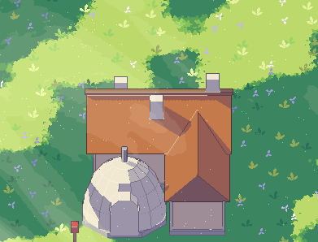
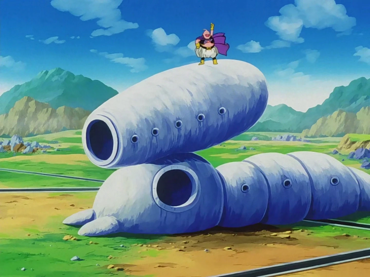
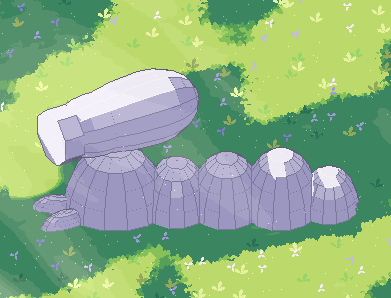

# Building guide

This guide says how to build a building from shapes. It is based on 2 examples: the Chichi house that Claude built by hand, and the Buu house. It shows how they were built and turns each step into a rule for any building.

The numbers here come from the 2 example plans. "My reading" means the plan does not show it: it is how I read what the plan does.

For now, buildings use plain colors, no textures (see section 7). Textures come later.

The examples:

| | Reference | Render in the game |
| --- | --- | --- |
| Chichi house: `example/chichi-house.json` |  |  |
| Buu house: `example/buu-house.json` |  |  |

The JSON is a plan, the format Infer returns (see `apps/asset-studio/server/shapes.ts`): `description`, `layout`, `shapes`, `textures`. In a plan, `faces` is a list of `{"face", "texture"}`. In `asset.json`, the same faces are a map from face name to slot.

## 0. Only the global form

> **Build only the global form of the building. Everything else is a texture.**

What matters is the global form: the outline and the volumes, so the building reads like the reference. The details do not matter now. They will be painted in textures later, so the result looks like the reference.

**Make a shape** only for a part that a texture cannot show and that is a simple form:

- the main volumes: walls, roofs, domes, wings, round bodies;
- parts that stick out of the outline: chimneys, pipes, an entrance block that comes out of a wall, feet;
- small things that stand alone, away from a wall: a mailbox, a post.

**Do not make a shape** for anything that lies on a surface. It will be a texture on that surface:

- doors, even the door that opens. The door will open and close as a texture;
- windows, portholes, and window frames;
- signs and marks;
- holes and openings: a round door hole, the open end of a tube;
- steps, frames, trim, bricks, planks, roof tiles, stones.

The test: could it be painted on the surface of a bigger shape and still read right? Then it is a texture, not a shape.

Chichi house:

- Shapes: the walls, the 2 roofs, the ridge board, the 3 chimneys, the dome and its pipe, the white arch block that comes out of the dome, the wing, and the mailbox on its post. The 3 chimneys stick up from the roof, so a texture cannot show them.
- Textures later: the 2 doors, the 2 windows, the red sign, the steps.

Buu house:

- Shapes: the head dome, the 4 segments, the 2 feet, and the tube on top. The front of the tube is only a flat round side.
- Textures later: the round door hole on the head (the "eye"), the hole in the front of the tube, and all the small round windows.

This differs from `../style/rules.md`, which makes doors, windows, and posts real shapes and gives each door the role "door". For buildings, follow this guide.

### Keep the shapes simple

This is 3D pixel art. A building is a few plain blocks, not a detailed model. The renderer, the outlines, and the colors give the look.

Do not make:

- rounded edges or bevels,
- curved roofs,
- frames or trim built from many pieces.

If a part reads fine as one box, it is one box. The whole Chichi main house is 1 box for the walls (`walls`) and 1 wedge for the roof (`roof`). A base, a ridge board, and 3 chimneys add 5 more boxes. That is all.

Round things stay plain too. A cylinder has 8 flat sides and a dome has 14 sides and 5 bands (`packages/asset-format/src/geometry.ts`).

## 1. Coordinates

- 1 unit is 1 m.
- The ground is at y = 0. y goes up.
- x runs left to right: +x is right.
- The front faces +z, toward the camera. Parts with a larger z stand more to the front.
- `size` is [width x, height y, depth z].
- `position` is the center of the bottom of the shape. A shape at y = 0.16 stands on top of something 0.16 high.
- `rotationY` turns the shape around y, in degrees. Positive turns its front toward +x.
- `tilt` leans the shape around x, in degrees, after the turn. Positive leans its top toward the front. Negative leans it back, so its front faces up.

Chichi: the main house is centered on x = 0, z = 0. Its walls run from x -1.8 to 1.8 and z -1.2 to 1.2. The dome and the wing stand in front of it, at larger z.

## 2. Write the text first

Before any shape, write 2 texts:

- `description`: one sentence about the whole building.
- `layout`: each part, where it is (back, front left, front right), its x and z range, and checks with numbers that parts do not cut into each other.

Chichi `description`:

> Chichi's house: a cream brick house with a brown tile roof and three white chimneys, a white dome house in front on the left, and a wing on the right with its gable to the front.

The Chichi `layout` gives each part its range and checks it:

| Part | Where | x | z | Check in the layout |
| --- | --- | --- | --- | --- |
| Main house | back | -1.8 to 1.8 | -1.2 to 1.2 | |
| Dome | front left | -2.17 to 0.23 | 1.4 to 3.8 | stands whole in front of the main house: 1.4 > 1.2 |
| Wing | front right | 0.36 to 1.8 | 0.4 to 3.6 | starts right of the dome: 0.36 > 0.23 |

The layout also gives the numbers the shapes need later: the dome center (x -0.97, z 2.6), its radius 1.2 and height 1.68, and the roof height (1.15 m over 2.4 m). It ends by saying which details will be textures.

The wing goes into the main house from z 0.4 to 1.2. The layout says so: "that joins the main house". Walls that join may touch. The dome does not touch the main house.

Then write the shapes from the layout. The shapes must match the layout. The dome is 2.4 wide at x -0.972, so it runs from x -2.172 to 0.228: the range in the layout.

## 3. Build order and parts

Build in this order. Each step names the Chichi shapes.

| Step | Part | Chichi shapes |
| --- | --- | --- |
| 1 | Stone base | `base` |
| 2 | Walls | `walls` |
| 3 | Wedge roof | `roof` |
| 4 | Ridge board | `ridge` |
| 5 | Chimneys | `chimney-1`, `chimney-2`, `chimney-3` |
| 6 | Second volumes | the dome on its ring: `dome-ring`, `dome`, `dome-pipe`; the wing: `wing-base`, `wing-walls`, `wing-roof` |
| 7 | Blocks that stick out | the entrance block of the dome: `arch`, `arch-top` |
| 8 | Small props | `mailbox-post`, `mailbox` |

The order of shapes in the file does not change the model.

Each part sits on the part under it:

- The walls start at y 0.16, the top of the base.
- The roof starts at y 1.3, the top of the walls (0.16 + 1.14).
- The dome starts at y 0.16, the top of its ring. The wing walls start at y 0.16, the top of the wing base.
- The arch starts at y 0.16, the floor height of the ring.
- The mailbox post stands on the ground, at y 0.

A second volume (the dome, the wing) gets its own base, like the main house.

The stone base: a building with walls, like the Chichi house, stands on a low stone base (`rules.md`). A round building that sits on the ground in its reference, like the Buu house, gets no base. Follow the reference.

## 4. Sizes

All sizes are measured from the Chichi plan.

### Base

- 0.16 high.
- It sticks out 0.07 past the walls on each side. Main house: base 3.74 × 2.54 under walls 3.6 × 2.4. Wing: base 1.58 × 3.34 under walls 1.44 × 3.2.
- The dome ring is the base of the dome: also 0.16 high, 2.56 wide under the 2.4 dome, so it sticks out 0.08.

### Walls

- Main house: the wall box is 3.6 × 1.14 × 2.4. On the base, its top is at y 1.3.
- Wing: the wall box is 1.06 high. Its top is at y 1.22, a little lower than the main house.
- The right wall of the wing is in line with the right wall of the main house (both at x 1.8).

### Roof

- Main roof: a wedge 4.12 × 1.15 × 2.92 over walls 3.6 × 2.4. It hangs over the walls by 0.26 on each side, in x and in z (4.12 vs 3.6, 2.92 vs 2.4).
- It is 1.15 high, so the slope is about 38°. The peak is at y 2.45.
- Wing roof: a wedge 3.6 long, 1.84 wide, 0.9 high, turned 90°, over walls 3.2 × 1.44. It hangs over by 0.2 on each side. Its slope is about 44°. The peak is at y 2.12.
- The bottom of a roof is at the top of its walls.

### Ridge board

- 4.18 long, 0.1 high, 0.18 wide.
- 0.03 longer than the roof at each end (4.18 vs 4.12).
- Its bottom is at y 2.4 and the roof peak is at 2.45, so half of it sits in the roof and half stands above.
- Only the main roof gets a ridge board. A smaller roof, like the wing roof, has none: one shape less, and the house still reads the same.

### Chimneys

- All 3 are 0.4 × 0.75 × 0.32.
- They sink into the roof. On a roof slope, the roof height at a distance |z| from the ridge is: y = 1.3 + 1.15 × (1 − |z| / 1.46).
- `chimney-1` runs from z -0.64 to -0.32. The roof there is at y 1.946 and 2.198. The chimney bottom is at 1.815: 0.13 below the low edge. Its top is at 2.565: 0.37 above the high edge. `chimney-2` is the same on the front slope.
- `chimney-3` stands near the ridge: its bottom is 0.065 below the low edge, and its top (2.933) is 0.43 above the ridge board.

### Other parts

- `dome`: 2.4 wide and deep, 1.68 high. A true half-sphere would be 1.2 high; this dome is taller.
- `dome-pipe`: 0.2 wide, 0.52 high. Its bottom is at y 1.74 and the dome top at 1.84, so it sinks 0.1 into the dome.
- Entrance block of the dome: a white box (`arch`) 0.84 × 0.8 × 0.42 with a half disc of radius 0.42 on top (`arch-top`). It comes 0.09 out of the front of the dome (front at z 3.89, dome front at 3.8). The door on it will be a texture.
- Mailbox: a post 0.08 × 0.6 × 0.08 and a box 0.24 × 0.2 × 0.3 on top of it, at y 0.6. 0.8 high in all.

### Compared with rules.md

| rules.md | Chichi |
| --- | --- |
| Walls 1.2 to 1.4 m high | 1.3 (main) and 1.22 (wing), from the ground. The wall boxes alone are 1.14 and 1.06. My reading: rules.md counts from the ground, base included. |
| A door about 0.6 × 0.85 m | Not a shape now. Use this size when the door is painted. |
| A small house about 3.6 × 2.4 m | Main walls 3.6 × 2.4. |
| Roofs hang over by about 0.25 m | 0.26 (main), 0.2 (wing). |
| A thin ridge board | 0.1 high, 0.18 wide, on the main roof only. |
| A low stone base | 0.16 high. |

## 5. Shape types

| Type | Faces | Use it for | In Chichi | In Buu |
| --- | --- | --- | --- | --- |
| box | front, back, left, right, top, bottom | walls, bases, chimneys, entrance blocks, posts | 11 | 0 |
| cylinder | side, top, bottom (8 flat sides) | round bases, pipes, round tops and flat round ends (laid on its side) | 3: `dome-ring`, `dome-pipe`, `arch-top` | 1: `tube-rim` |
| wedge | front and back (the 2 slopes), left and right (the triangle ends), bottom | gable roofs | 2: `roof`, `wing-roof` | 0 |
| pyramid | front, back, left, right, bottom | My reading: roofs with 4 slopes, pointed tops | 0 | 0 |
| dome | side, bottom (14 sides, 5 bands) | round houses and round bodies. Width, depth, and height may differ | 1: `dome` | 11 |

### A wedge with its gable to the front

A wedge has its ridge along x. With `rotationY: 0` its slopes face the front and the back, and its triangle ends face left and right. That is the main roof.

To make a gable face the front, turn it: `rotationY: 90`. The wing roof does this:

- `size` stays [ridge length, height, width]. So `wing-roof` is [3.6, 0.9, 1.84]: 3.6 now runs along z (0.2 to 3.8) and 1.84 along x (0.16 to 2.0).
- The `left` face now faces the front (+z) and the `right` face faces the back. The `front` slope faces right (+x) and the `back` slope faces left.
- The back end of the wing roof is at z 0.2, inside the main roof. There the main roof is at y 2.29, above the wing peak (2.12), so the back gable is hidden. My reading: a roof that meets a bigger roof ends inside it.

### A cylinder with `tilt: 90` for an arch top

With `tilt: 90` a cylinder lies on its side. Its flat faces look to the front and the back. Its height becomes its depth along z. Its position is still the center of its bottom, which is now the center of its back face.

- `arch-top`: size [0.84, 0.43, 0.84], position y 0.96, z 3.47, tilt 90. It is a disc of radius 0.42, centered at y 0.96 (the top of the arch box), from z 3.47 (the back of the arch box) to 3.90.
- Its lower half is inside the arch box, so only the upper half shows: a round top.
- It is 0.01 deeper than the box under it (0.43 vs 0.42), so its front stands just in front of the box front. My reading: so the 2 fronts do not lie in the same plane.

## 6. Round bodies lying down

The Buu house shows how to build round forms that lie down, such as the tube on its head.

### Laying a shape along a direction

With `tilt: 90`, the height of a cylinder or a dome lies flat. Its axis then points along (sin r, 0, cos r), where r is `rotationY`. To lay it along a direction u seen from above, use r = atan2(u.x, u.z).

The Buu tube runs to the back right, 30° from x: u = (0.866, 0, -0.5), so r = 120. A dome laid with `rotationY: 120` points its round top to the back right. With `rotationY: -60` (120 − 180) it points to the front left.

### An egg shape: 2 domes back to back

2 domes with the same center and the same width, one pointing each way, make an egg. Each half can have its own length. The front and back of the Buu tube are made this way.

### A flat round end

A dome ends in a round point. To cut a round body flat, put a short cylinder (laid the same way) at the end, with its front face where the flat end should be. The tip of the dome must stay inside that cylinder. The Buu tube does this with `tube-rim`: 1.36 wide, its front face is the flat front of the tube. The hole in it will be a texture.

### A steady swelling

One egg swells fast near its tip, then slowly. To make a body that grows slowly and steadily, like the Buu tube, put 2 eggs one after the other: a thinner one in front and a fatter one behind. Size them so the outline rises with no dip, and keep each tip hidden inside the other egg or the rim. The Buu tube: the outline is 0.63 m (radius) at the front, grows steadily to 0.88 m at two thirds of its length, then ends in a round back.

## 7. Colors

For now there are no textures. Each texture slot is used only for its plain `color`.

### One slot per material

Chichi house:

| Slot | Color | Used on |
| --- | --- | --- |
| grey | #b8b4b0 | bases, dome ring, dome pipe |
| cream | #f2dab0 | walls, wing walls |
| tile | #c47a4a | both roofs: slopes and bottom |
| wood | #ab7c58 | ridge board, triangle ends of both roofs, mailbox post |
| white | #f0e8d0 | dome, arch, arch top, chimneys |
| red | #c83a3a | mailbox |

Buu house: 1 slot, `white` (#eeebf5), on every shape.

- One slot per material, not one slot per part.
- The same material has the same color everywhere.
- Daylight colors only. The Chichi reference is lit by an orange evening light. The plan uses plain day colors: cream #f2dab0, white #f0e8d0, not orange.
- A slot color is the color in the sun. The renderer makes the shade tones.

### Which face gets which color

- A shape is one color on all its faces: the color of its part. Walls are cream, chimneys white, bases grey.
- The bottom gets that color too. Do not use `null`. A shape laid on its side shows its bottom: the flat front of the Buu tube is the `bottom` face of `tube-rim`. A `null` face shows the grey fallback color there.
- A roof wedge is the only shape with 2 colors: its slopes and bottom are `tile`, its triangle ends (`left`, `right`) are `wood`. This is the same for every roof.

Why wood on every triangle end: the camera looks straight along -z and never turns. A roof with its ridge along x has its triangle ends looking left and right, so the camera never sees them. Only a turned roof, like the wing roof, shows a triangle end, and there the plan uses wood. So one rule gives the same picture.

### widthM, heightM, and description

The schema still needs `widthM`, `heightM`, and `description` on each slot. They do not change a plain color. Keep them ready for when textures come: `widthM` × `heightM` is the size of the main face the slot covers (cream 3.6 × 1.2, about the front wall), and `description` says what to paint.

### What changed from Claude's Chichi plan

| Change | Why |
| --- | --- |
| `description`: "Goku's house" became "Chichi's house". | The right name. |
| Main roof triangle ends: `cream` became `wood`. | One rule for every roof. The camera never sees these faces. |
| Every `null` face got the color of its part. | A `null` face that shows is grey. |
| The 2 doors, the round door top, the 2 windows, the sign, and the 2 steps were removed, with the `sign`, `dome-window`, and `glass` slots. | Only the global form. They will be textures. |

The plan went from 25 to 17 shapes.

## 8. Limits

- At most 30 shapes (`MAX_SHAPES` in `schema.ts`). Chichi uses 17: 11 boxes, 3 cylinders, 2 wedges, 1 dome. Buu uses 12: 11 domes and 1 cylinder.
- Only 5 shape types: box, cylinder, wedge, pyramid, dome.
- No doors, windows, signs, holes, steps, or surface details as shapes. They will be textures.
- No shape has `role: "door"` for now. The door will open and close as a texture.

## 9. Checklist

Check a new building against this list before it is done.

1. Is every shape part of the global form? Could a part be painted on a bigger shape instead? Then remove it: it will be a texture.
2. Could any part be a simpler shape, or fewer shapes? Then make it simpler.
3. There is a one-sentence `description` and a `layout` with every part, its x and z range, and checks with numbers. The layout says which details will be textures.
4. The front faces +z. The ground is at y = 0. Each `position` is the center of the bottom of its shape.
5. Every part sits on the part under it. Nothing floats. Chimneys and pipes sink into their roof or dome.
6. A building with walls has a base 0.16 high, 0.07 past the walls, and each second volume has its own. A round building on the ground in its reference has none.
7. Walls are 1.2 to 1.4 m high from the ground. Roofs hang over by about 0.2 to 0.26 m. Only the main roof has a ridge board.
8. Parts side by side do not cut into each other. Only walls that join, and parts that grow out of each other (segments, eggs), touch.
9. One slot per material, plain colors, daylight colors.
10. Each shape is one color on all its faces, bottom too, with no `null`. Roofs: slopes and bottom `tile`, triangle ends `wood`.
11. 30 shapes or fewer, of the 5 types only.
