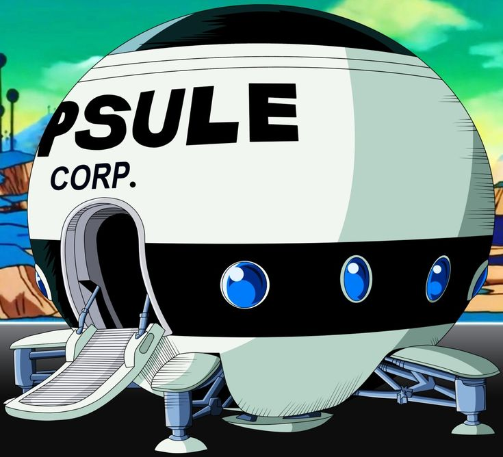
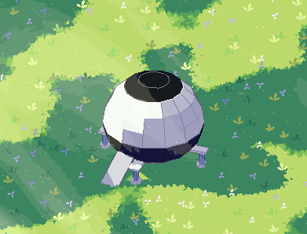

# Building guide

This guide says how to build a building from simple shapes, starting from a reference image.

It is based on 3 examples. Look at them first:

| | Reference | Render in the game |
| --- | --- | --- |
| Chichi house: `example/chichi-house.json` (17 shapes) |  |  |
| Buu house: `example/buu-house.json` (13 shapes) |  |  |
| Capsule Corp ship: `example/capsule-ship.json` (18 shapes) |  |  |

A building is a plan: a JSON file with `description`, `layout`, `shapes`, and `textures` (the format Infer returns, see `apps/asset-studio/server/shapes.ts`).

What is in this folder:

| Path | What it is |
| --- | --- |
| `README.md` | this guide |
| `example/` | the 3 example plans, their reference images, their game renders, and comparison images (`*-compare-*.png`) |
| `example/build-buu-house.py`, `example/build-capsule-ship.py` | the scripts that build `buu-house.json` and `capsule-ship.json` from their measures |
| `tools/preview/` | the tool that draws a plan, to compare it with the reference (see its `README.md`) |
| `tools/scene/` | the tool that draws several plans on grass with characters (see its `README.md`) |
| `textured/` | the 3 examples with their textures, and the scripts that paint them with Infer (see its `README.md`) |
| `new-building-prompt.md` | a prompt to give a new chat, to build a new building from a reference image |
| `raditz-pod-prompt.md` | the same prompt, for Raditz's space pod |
| `example/raditz-pod.json`, `example/raditz-pod-open.json`, `example/build-raditz-pod.py` | Raditz's space pod, closed and open: a sphere whose door is cut out of its own quads (the `pod` block, read by `tools/scene` and `tools/preview`; the game format cannot do it yet). Its images: `example/raditz-pod-*` |

## 1. The 3 main rules

### Rule 1: only the global form

> **Build only the global form: the outline and the volumes. Everything else is a texture.**

The details will be painted in textures later. For now they are not made at all.

**Make a shape** only for a part that a texture cannot show:

- the main volumes: walls, roofs, domes, round bodies;
- parts that stick out: chimneys, pipes, a block that comes out of a wall, fins;
- small things that stand alone: a mailbox, a post.

**Do not make a shape** for anything that lies on a surface:

- doors (even the door that opens: it will open as a texture);
- windows, portholes, frames;
- signs and marks;
- holes and openings, and the rim around them;
- steps, trim, bricks, planks, tiles, stones.

The test: could it be painted on a bigger shape and still read right? Then it is a texture.

| | Shapes | Textures later |
| --- | --- | --- |
| Chichi | walls, 2 roofs, ridge board, 3 chimneys, dome and its pipe, the white entrance block on the dome, the wing, the mailbox on its post | 2 doors, 2 windows, the red sign, the steps |
| Buu | the head, 4 segments, 2 fins, the tube on top | the round hole on the head, the hole in the front of the tube, all the small round windows |

This differs from `../style/rules.md`, which makes doors and windows real shapes with the role "door". For buildings, follow this guide.

### Rule 2: follow the reference exactly

The building must look like the reference. Do not invent shapes.

- **Measure, do not guess.** Take one part as a scale and measure the others against it: length, height, depth, thickness. Note where each part is highest and where it is thinnest.
- **Copy the global shape of each part.** If a part is long and round at the same time, like the Buu head, build it long and round. If it is fattest in the middle, build it fattest in the middle.
- **Keep parts straight.** Parts run along the body, not at an angle. Turn or tilt a part only when the reference clearly shows it, and then only a little. (The Buu tube is turned only 15°; the Buu fins point straight.)
- **Add nothing the reference does not have.** No extra base, block, or ring. A building that sits on the ground in its reference sits on the ground.
- **A cut is a cut.** When a part ends flat, like the front of the Buu tube, it is cut like a sausage with a knife: a full, flat face. Nothing comes out of it and it is not hollow. The hole or rim you see on the reference is a texture.

### Rule 3: keep the shapes simple

This is 3D pixel art. A building is a few plain blocks. The renderer, the outlines, and the colors give the look.

- No rounded edges, bevels, or curved roofs.
- No frames or trim built from many pieces.
- If a part reads fine as one box, it is one box.

The whole Chichi main house is 1 box for the walls and 1 wedge for the roof, plus a base, a ridge board, and 3 chimneys.

## 2. How to build a building, step by step

1. **Look at the reference.** List the big parts and where they are: back, front left, front right, on top.
2. **Measure.** Pick a scale (for example, the width of the main part) and measure every big part: length, height, depth, where it is highest, how it joins the next part.
3. **Write the text.** Write the `description` and the `layout` (section 3).
4. **Build the shapes, biggest first:**
   1. base (only for a building with walls, see section 6);
   2. walls or main body;
   3. roofs, then the ridge board;
   4. chimneys and pipes;
   5. second volumes (a dome, a wing, segments), each with its own base if the main part has one;
   6. blocks that stick out;
   7. small things that stand alone.
5. **Compare with the reference.** Draw the building from the same angle as the reference and put the two side by side, with `tools/preview` (`view`, then `compare`). Check the length, the height, the depth, the outline of each part, and where it is highest. Fix what is different and draw again. Repeat until it matches. Then check the game view (`game`) and the other sides (`turns`): nothing floats, nothing cuts through. The Buu house shows what to aim for: `example/buu-compare-side.png` and `example/buu-compare-game.png`.
6. **Go through the checklist** (section 9).

## 3. Write the text first

Before any shape, write 2 texts:

- `description`: one sentence about the whole building.
- `layout`: each part, where it is, its x and z range, and checks with numbers that parts do not cut into each other. End with the details that will be textures.

Chichi `description`:

> Chichi's house: a cream brick house with a brown tile roof and three white chimneys, a white dome house in front on the left, and a wing on the right with its gable to the front.

The Chichi `layout` gives each part its range and checks it:

| Part | Where | x | z | Check |
| --- | --- | --- | --- | --- |
| Main house | back | -1.8 to 1.8 | -1.2 to 1.2 | |
| Dome | front left | -2.17 to 0.23 | 1.4 to 3.8 | in front of the main house: 1.4 > 1.2 |
| Wing | front right | 0.36 to 1.8 | 0.4 to 3.6 | right of the dome: 0.36 > 0.23 |

The wing goes into the main house: walls that join may touch. Then write the shapes from the layout, with the same numbers.

## 4. Coordinates

- 1 unit is 1 m. The ground is at y = 0.
- x runs left to right. The front faces +z, toward the camera.
- `size` is [width x, height y, depth z].
- `position` is the center of the bottom of the shape.
- `rotationY` turns the shape around y, in degrees. Positive turns its front toward +x.
- `tilt` leans the shape around x, in degrees, after the turn. Positive leans its top to the front.

The camera looks down about 33° toward -z and never turns.

## 5. Which shape for which part

There are 5 shape types. A cylinder has 8 flat sides; a dome has 14 sides and 5 bands.

| Type | Faces | Use it for |
| --- | --- | --- |
| box | front, back, left, right, top, bottom | walls, bases, chimneys, blocks, posts |
| cylinder | side, top, bottom | round bases, pipes, a round top (laid on its side) |
| wedge | front and back (the slopes), left and right (the triangle ends), bottom | gable roofs |
| pyramid | front, back, left, right, bottom | roofs with 4 slopes, pointed tops |
| dome | side, bottom | round houses and every round body (width, depth, and height may differ) |

### Roofs

A wedge has its ridge along x. To make its gable face the front, use `rotationY: 90` (the Chichi wing roof). Its `left` face then faces the front. A roof that meets a bigger roof ends inside it.

### A round top on a block

A cylinder with `tilt: 90` lies on its side, its flat faces to the front and back. Put it on top of a box, as deep as the box: only its upper half shows, as a round top (the Chichi `arch-top`).

### Laying a shape down

With `tilt: 90`, a cylinder or a dome lies flat. To lay it along a direction u seen from above, use `rotationY` = atan2(u.x, u.z). To raise its far end by a few degrees a, use `tilt: 90 − a`. A shape laid the other way uses `rotationY` − 180 and `tilt: 90 + a`.

### Round bodies

The Buu house is made of these recipes:

- **An egg:** 2 domes with the same center and width, one pointing each way. Each half has its own length: a short half is blunt, a long half is pointed.
- **A body long and round at the same time** (the Buu head): an egg laid along the ground, its axis a little above the ground. The lower part is under the ground and does not show. Choose the 2 half lengths so the highest point is where the reference has it.
- **A small pointed part on the ground** (the Buu fins): one dome laid on its side, its flat base hidden in the body, its point out. Make it fat and short, so the thick part shows.
- **A flat cut** (the front of the Buu tube): lay one more dome pointing back into the body, its flat base where the cut is. That base is the full, flat face. Keep every egg tip just behind the cut.
- **A body fattest in the middle with a flat front** (the Buu tube): a main egg, fattest in the middle, whose back half is the round back; and a short, blunt front egg that rounds the body down to the flat cut. Check the outline from front to back: it rises with no dip, then falls.
- **Sitting on a round part:** find the lowest point of the body over the part under it and sink it about 0.15 into it (the Buu tube sits 0.14 into the head).
- **Parts that join**, like the Buu segments, press into each other: the segments overlap by 0.5, and segment 1 goes 0.6 into the head.

## 6. Sizes

These sizes come from the Chichi house. Use them for a house with walls, unless the reference shows other proportions.

| Part | Size |
| --- | --- |
| Stone base | 0.16 high, 0.07 wider than the walls on each side |
| Walls | 1.2 to 1.4 high from the ground, base included (Chichi: 1.3 and 1.22). A small house is about 3.6 × 2.4. |
| Roof | hangs over the walls by 0.2 to 0.26 on each side. Its bottom is at the top of the walls. Chichi: 1.15 high, slope about 38°. |
| Ridge board | 0.1 high, 0.18 wide, 0.03 longer than the roof at each end, half sunk in the roof. Only on the main roof. |
| Chimney | 0.4 × 0.75 × 0.32, sunk into the roof at its low edge, standing about 0.4 above it |
| Pipe on a dome | 0.2 wide, 0.52 high, sunk 0.1 into the dome |
| Door (texture) | about 0.6 × 0.85, when it is painted |

The base: a building with walls, like Chichi, stands on a low stone base, and each second volume gets its own. A round building that sits on the ground in its reference, like Buu, has no base.

## 7. Colors

For now there are no textures. Each texture slot is only a plain `color`.

- One slot per material, not one per part. Chichi has 6 (grey, cream, tile, wood, white, red); Buu has 1 (white).
- Daylight colors only, even when the reference is lit by evening light. The color is the color in the sun; the renderer makes the shade.
- A shape is one color on all its faces, bottom too. Never use `null`: a face that shows with `null` is grey.
- A roof is the only shape with 2 colors: slopes and bottom `tile`, triangle ends `wood`.
- `widthM`, `heightM`, and `description` are still needed on each slot. They do not change a plain color. Fill them for later: `widthM` × `heightM` is the size of the main face the slot covers, and `description` says what to paint.

## 8. Limits

- At most 30 shapes, of the 5 types only.
- No doors, windows, signs, holes, steps, or surface details as shapes.
- No shape has `role: "door"` for now.

## 9. Checklist

1. Is every shape part of the global form? Could it be painted instead? Then remove it.
2. Could any part be simpler, or be fewer shapes?
3. Does each part have the length, height, and depth of the reference, and the same outline? Did you compare side by side with the reference?
4. Are the parts straight along the body, unless the reference clearly shows an angle?
5. Is there nothing extra that the reference does not have? Are flat cuts full faces?
6. Is there a one-sentence `description` and a `layout` with ranges and checks?
7. Does every part sit on the part under it, with nothing floating and nothing cutting through? Look at the other sides too.
8. Base, walls, roofs: do they follow section 6 (for a building with walls)?
9. One slot per material, daylight colors, every face colored, no `null`?
10. 30 shapes or fewer?
